# Real-Time Enterprise SALOC CRM Web Application

A web-based Enterprise Customer Relationship Management (CRM) application designed to streamline customer information management, centralize business data, and support efficient business operations.

## Project Overview

SALOC CRM is an enterprise business application developed to manage customer information and multiple business processes through a centralized web platform.

The application provides structured customer data management, business intelligence, financial information, reporting, and user access management.

## Key Modules

- Customer Master 
- Business Profile 
- Company Profile 
- Financial Intelligence
- Credit Assessment
- Annual Purchase 
- Installed Brands
- Decision Maker 
- Sales Intelligence
- Customer Relationship 
- Risk Analysis
- Reports 
- Audit Log
- User Management
- Dropdown Management

## Technology Stack

- **Backend:** C#, ASP.NET Core MVC, .NET
- **Database:** Microsoft SQL Server
- **Frontend:** HTML5, CSS3, JavaScript
- **Hosting:** IIS (Internet Information Services)

## Project Highlights

- Centralized customer information management
- Role-based access control
- SQL Server database integration
- Business reports and analytics
- Audit tracking of user activities
- Internal web application deployment using IIS
- Structured management of customer and business information

## Application Screenshots

## Application Screenshots

### 1. Login Page

### 2. Dashboard
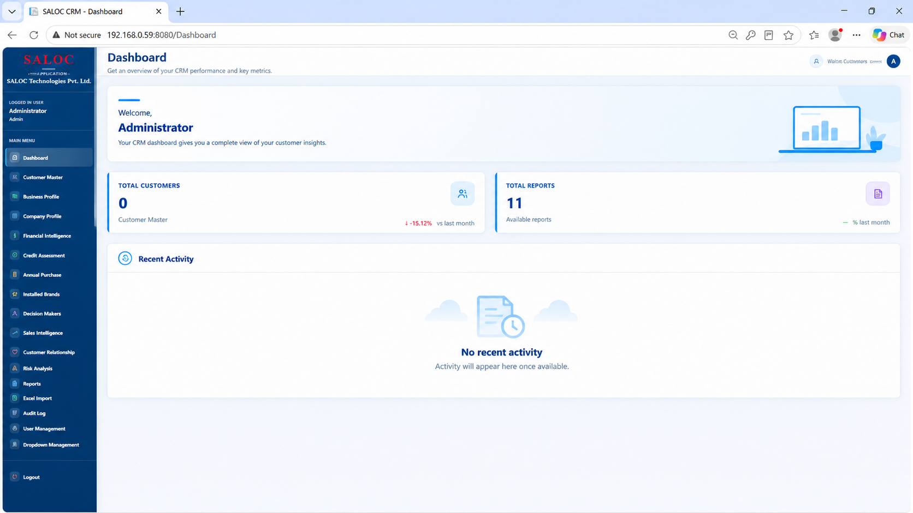

### 3. Customer Master
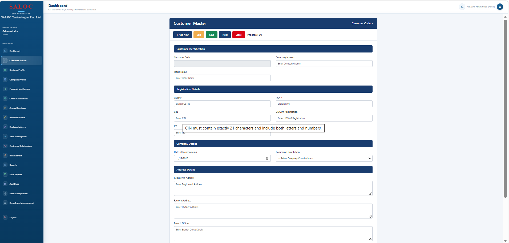

### 4. Business Profile
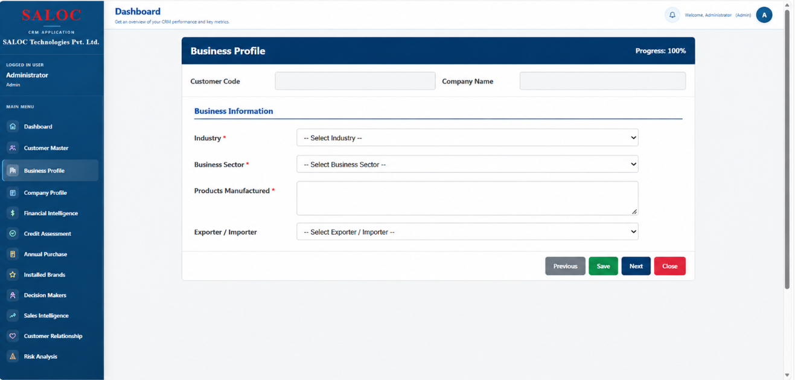

### 5. Company Profile
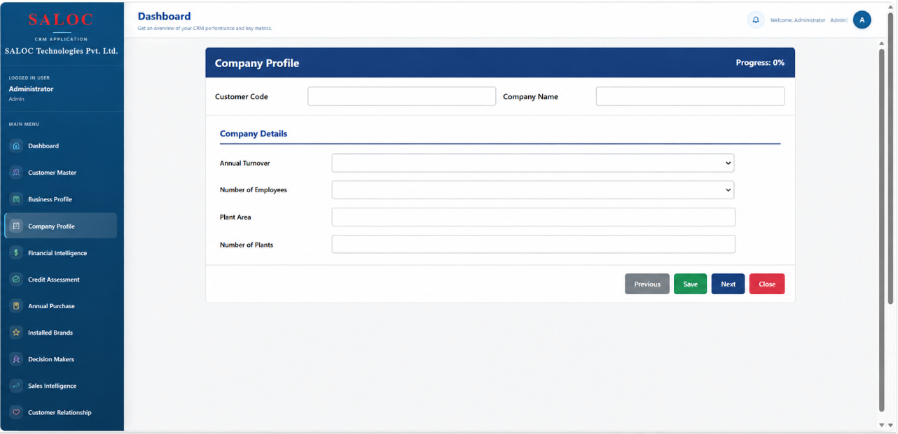

### 6. Financial Intelligence
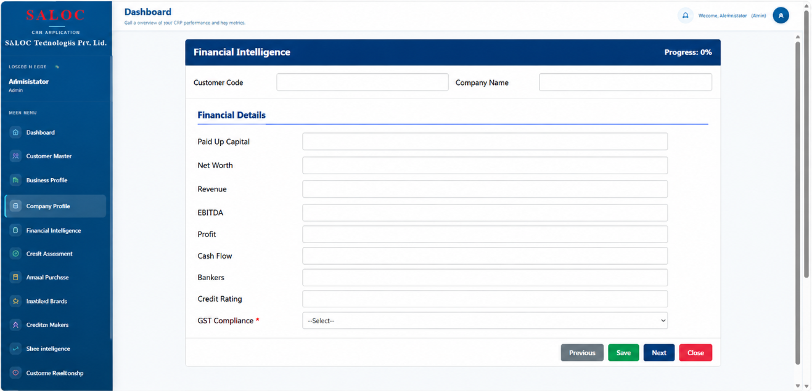

### 7. Credit Assessment
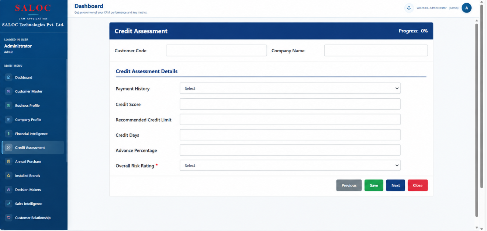

### 8. Annual Purchase
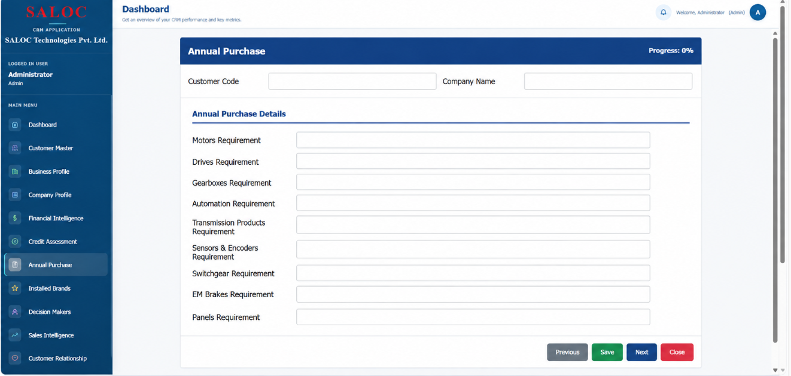

### 9. Installed Brands
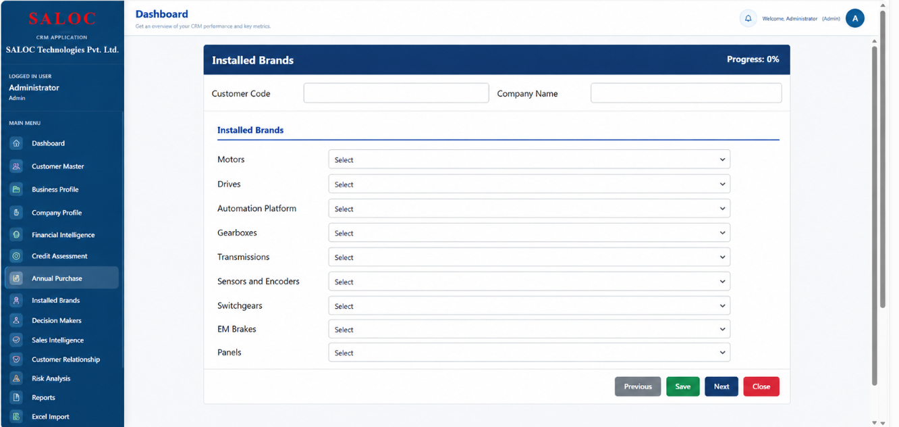

### 10. Decision Makers
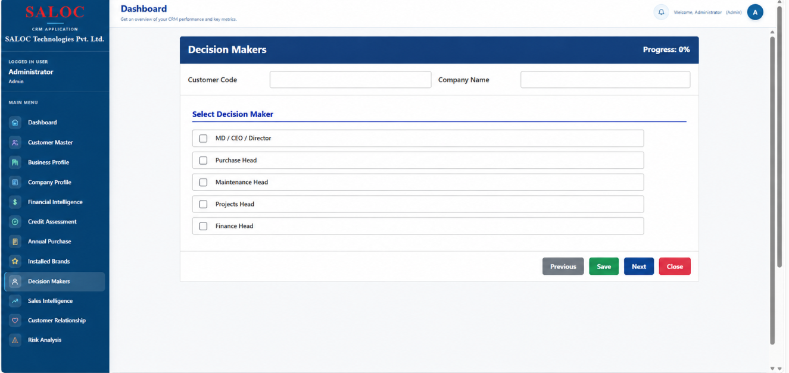

### 11. Purchase Head
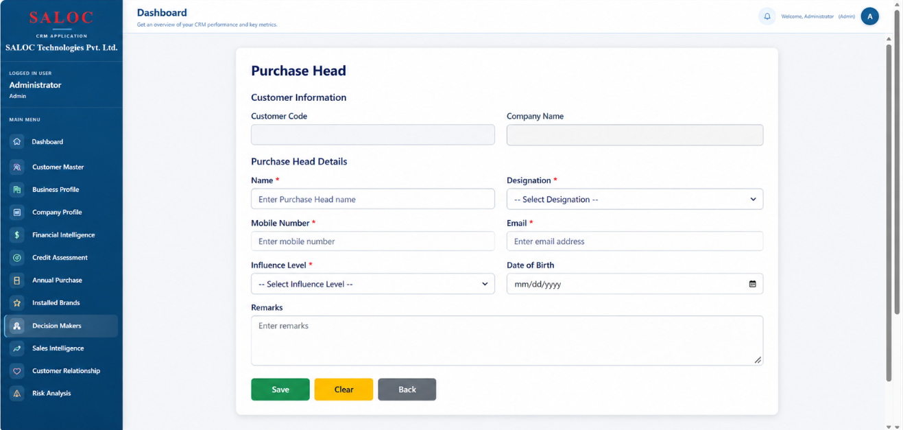

### 12. Sales Intelligence
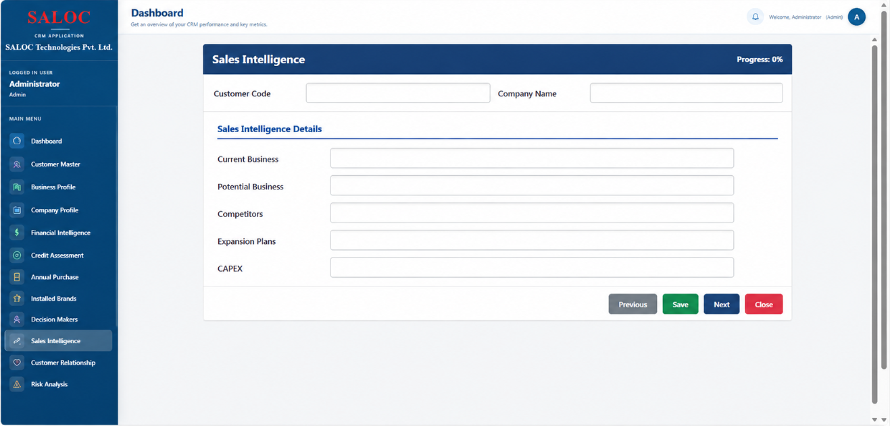

### 13. Customer Relationship

### 14. Risk Analysis
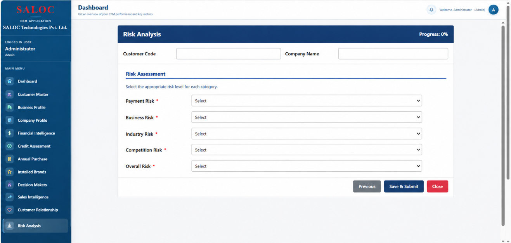

### 15. Reports
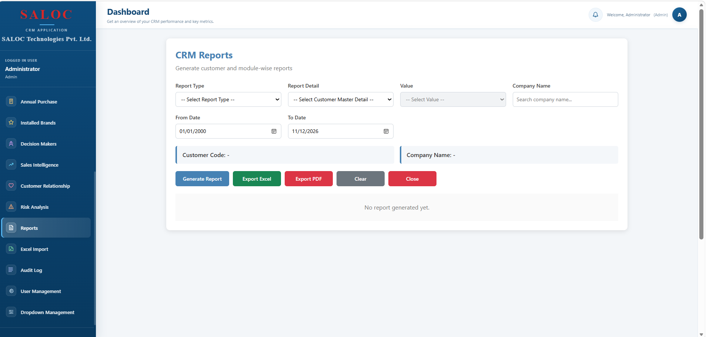

### 16. Audit Log
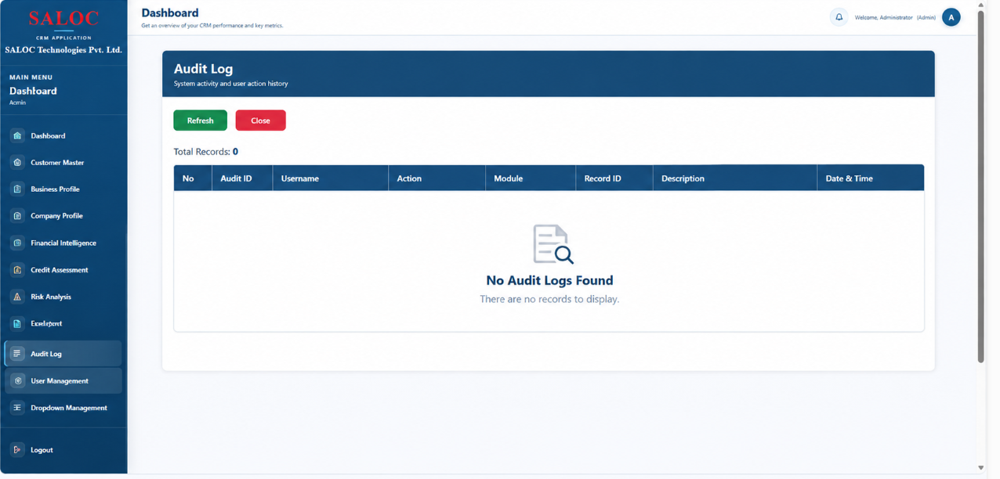

### 17. User Management
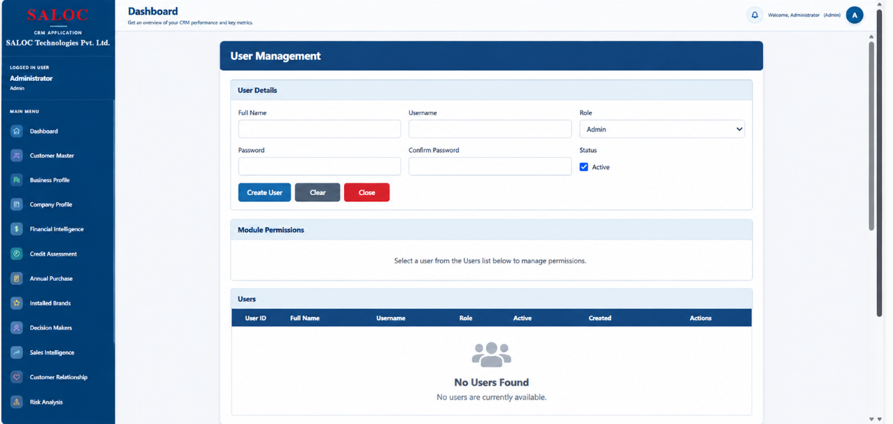

### 18. Dropdown Management
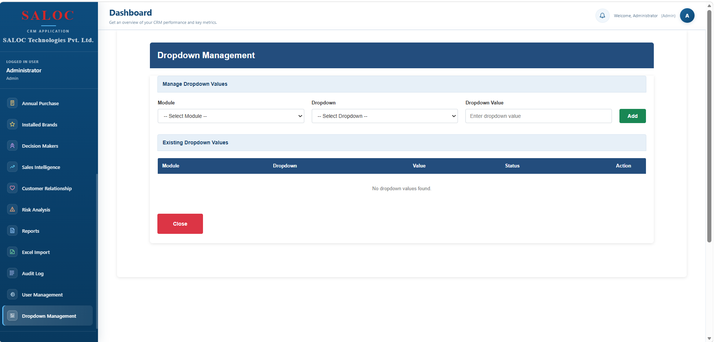
## Project Objective

To develop a centralized CRM platform that simplifies customer data management, improves business information accessibility, supports reporting, and streamlines internal business workflows.

## Project Type

Real-time enterprise application development experience.

**Application Category:** Enterprise CRM | Business Management | Web Application
